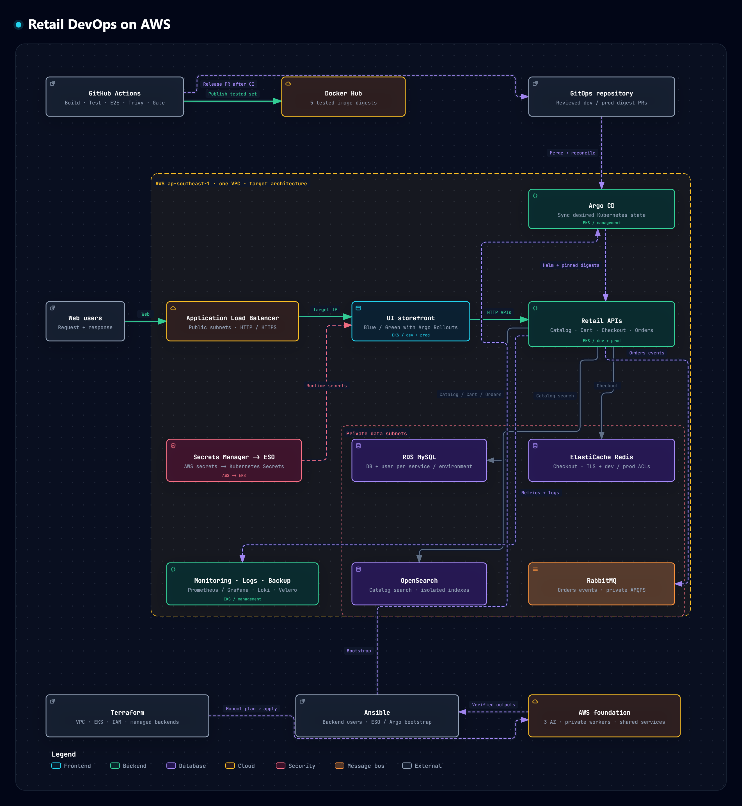

# Đồ án DevOps: Retail Store trên AWS

Xây dựng quy trình phát triển và triển khai một hệ thống bán lẻ theo kiến trúc microservices trên **Amazon EKS**, kết hợp **GitHub Actions, Docker, Terraform, Ansible, Helm và Argo CD**.

Đồ án phát triển từ ứng dụng mẫu [AWS Containers Retail Store](retail-store-sample-app/). Phần mở rộng tập trung vào kiểm thử, đóng gói và phát hành image, quản lý hạ tầng bằng code, triển khai qua GitOps, bảo vệ credential và xây dựng nền tảng giám sát, logging, backup.

| Phạm vi | Công nghệ chính |
| --- | --- |
| Ứng dụng | 5 microservices: UI, Catalog, Cart, Checkout, Orders |
| Container và CI | Docker, GitHub Actions, Nx, Trivy, Docker Hub |
| Hạ tầng AWS | VPC, EKS, ALB, RDS MySQL, ElastiCache Redis, Amazon MQ, OpenSearch, S3 |
| Infrastructure as Code | Terraform, Ansible |
| GitOps và phát hành | Helm, Argo CD, Argo Rollouts |
| Vận hành | Prometheus, Grafana, Loki, Alloy, Velero, External Secrets Operator |

## Mục tiêu đồ án

- Tự động hóa quá trình build, kiểm thử, quét bảo mật và phát hành container image.
- Kiểm thử đúng bộ image sẽ được publish; truy vết release theo source commit và image digest.
- Khai báo hạ tầng AWS bằng Terraform và bootstrap bằng Ansible để có thể dựng lại môi trường.
- Quản lý triển khai Kubernetes qua GitOps, tách cấu hình `dev` và `prod`.
- Kết hợp kiểm soát truy cập, quản lý bí mật, quan sát hệ thống và quy trình backup/restore.
- Hỗ trợ vòng đời lab **dựng → kiểm chứng → thu dọn**, có bước review trước khi tạo hoặc xóa tài nguyên.

## Kiến trúc tổng thể

[](assets/retail-devops-architecture.svg)

Nhấn vào sơ đồ để xem bản SVG có thể phóng to. Sơ đồ mô tả kiến trúc mục tiêu được khai báo trong code; trạng thái tài nguyên và hoạt động của ứng dụng cần được xác nhận sau khi triển khai trên AWS.

**Luồng truy cập ứng dụng:** người dùng → ALB public → UI trong private subnet → các API backend. Response trả về người dùng qua ALB. Các kết nối mới từ Pod ra Internet sử dụng đường egress/NAT riêng.

**Luồng phát hành:** source code → GitHub Actions → bộ image đã kiểm thử trên Docker Hub → PR cập nhật digest trong repo GitOps → Argo CD đồng bộ xuống EKS.

ALB và EKS nằm trong cùng VPC. ALB sử dụng public subnets; worker sử dụng private app subnets; các dịch vụ dữ liệu nằm trong private data subnets. AWS Load Balancer Controller tạo ALB và target group từ Kubernetes Ingress.

## Các thành phần ứng dụng

| Service | Công nghệ | Chức năng | Backend của đồ án |
| --- | --- | --- | --- |
| [UI](retail-store-sample-app/src/ui/) | Java 21, Spring Boot, Thymeleaf | Giao diện cửa hàng và kết nối các API | Các service nội bộ |
| [Catalog](retail-store-sample-app/src/catalog/) | Go, Gin, GORM | Danh mục sản phẩm và tìm kiếm | MySQL, OpenSearch |
| [Cart](retail-store-sample-app/src/cart/) | Java 21, Spring Boot | Quản lý giỏ hàng | MySQL |
| [Checkout](retail-store-sample-app/src/checkout/) | TypeScript, NestJS | Quản lý checkout và gửi yêu cầu tạo đơn hàng | Redis và API Orders |
| [Orders](retail-store-sample-app/src/orders/) | Java 21, Spring Boot | Lưu đơn hàng và xử lý sự kiện | MySQL, RabbitMQ |

Catalog, Cart và Orders dùng chung một RDS MySQL, tách database/user theo service và môi trường. Checkout dùng Redis với ACL và key prefix riêng cho dev/prod. OpenSearch phục vụ tìm kiếm, tách index và quyền theo môi trường; dữ liệu tìm kiếm có thể được reindex từ Catalog SQL.

Orders kết hợp outbox, publisher confirm, retry, dead-letter queue và xử lý chống trùng cho luồng sự kiện RabbitMQ.

## Nền tảng triển khai

| Thành phần | Cách sử dụng trong đồ án |
| --- | --- |
| **Amazon VPC** | Quy hoạch 3 AZ tại `ap-southeast-1`, tách public/app/data subnets; private app subnets dùng NAT, có S3 Gateway Endpoint. |
| **Amazon EKS** | Kubernetes `1.36`; managed node groups phân vai trò management/dev/prod bằng label, taint và quy tắc scheduling. |
| **ALB và Ingress** | Service ứng dụng giữ `ClusterIP`; ALB chuyển traffic tới Pod UI. Lab hỗ trợ HTTP giới hạn IP; domain/ACM bổ sung HTTPS. |
| **MySQL, Redis, RabbitMQ, OpenSearch** | Backend private; cấu hình và quyền truy cập tách theo service/môi trường. |
| **Secrets Manager và ESO** | Đồng bộ credential từ AWS Secrets Manager sang Kubernetes Secret; ứng dụng tham chiếu Secret ở runtime. |
| **IAM và IRSA** | GitHub Actions dùng OIDC cho Terraform; controller/workload sử dụng role riêng theo ServiceAccount. |
| **Argo CD** | Theo dõi repo GitOps, quản lý Application và Helm values theo môi trường. |
| **Argo Rollouts** | UI dùng Blue/Green, có active/preview service; production promote sau khi kiểm tra preview. |
| **Prometheus và Grafana** | Thu thập metrics, dashboard và Alertmanager; receiver bên ngoài được cấu hình khi triển khai. |
| **Loki và Alloy** | Thu thập, lưu trữ và tra cứu log; Loki sử dụng S3. |
| **Velero và S3** | Backup tài nguyên Kubernetes; có playbook kiểm tra vận hành và thử khôi phục. |
| **Autoscaling** | Cấu hình HPA, metrics-server và Cluster Autoscaler trong profile đầy đủ. |

## Quy trình CI/CD

### CI ứng dụng

Workflow [Retail CI](.github/workflows/ci.yml) chạy khi có PR vào `main`, push lên `main` hoặc dispatch thủ công.

1. **Plan:** đối chiếu thay đổi với project graph của Nx, xác định phạm vi kiểm tra. Push `main` và manual kiểm tra đầy đủ bộ service.
2. **Style và source tests:** kiểm tra format, workflow, Helm rendering; build/lint/test theo service và ghi nhận số test thực chạy.
3. **Build images:** build một lần đủ 5 image Linux/amd64, xuất archive kèm checksum và thông tin source commit/run.
4. **E2E:** sử dụng cùng archive để kiểm tra qua Docker Compose, Search và Kubernetes Kind; xác minh image thực chạy.
5. **Security scan:** Trivy quét cùng bộ image trước khi publish.
6. **Required gate:** `ci-required` kiểm tra trạng thái các job và bằng chứng test/scan; gate thiếu bằng chứng hoặc skip ngoài dự kiến sẽ fail.
7. **Publish:** khi chạy trên `main` và các gate đạt, tải lại archive đã kiểm thử rồi push lên Docker Hub; không rebuild tại bước publish.

| Service | Repository Docker Hub |
| --- | --- |
| UI | `hmannnguye/devops-retails-shop` |
| Catalog | `hmannnguye/devops-retails-shop-catalog` |
| Cart | `hmannnguye/devops-retails-shop-cart` |
| Checkout | `hmannnguye/devops-retails-shop-checkout` |
| Orders | `hmannnguye/devops-retails-shop-orders` |

Đầu ra release có đủ năm reference dạng `repository@sha256:...`, source commit, run/attempt và profile backend đã kiểm thử. Cấu hình đăng nhập Docker Hub sử dụng Variable `DOCKERHUB_NAMESPACE` và Secrets `DOCKERHUB_USERNAME`, `DOCKERHUB_TOKEN`.

### CD qua GitOps

Repo triển khai riêng: **[DevOps-retails-shop-gitops](https://github.com/hoi3dkhoiche-byte/DevOps-retails-shop-gitops)**.

1. Sau một lượt CI hợp lệ trên `main`, workflow [Retail GitOps](.github/workflows/gitops.yml) có thể tạo PR cập nhật digest cho dev.
2. PR được review và merge; Argo CD tự đồng bộ workload dev sau khi cluster và cấu hình triển khai đã được kích hoạt.
3. Operator kiểm tra runtime và chạy nghiệm thu dev trên đúng bộ digest; bằng chứng được lưu trong GitOps.
4. Workflow promote production được chạy thủ công, tạo PR dùng đúng năm digest đã nghiệm thu cùng bằng chứng tương ứng.
5. Sau khi merge, workload production được sync thủ công; UI Blue/Green được promote sau khi kiểm tra preview.

Automation tạo PR dùng Secret `GITOPS_TOKEN` và Variable `GITOPS_ENABLED=true`. Rollback release thực hiện qua Git, đưa cả image values và bằng chứng tương ứng về release ổn định.

### Terraform và Ansible trong CI

| Workflow | Khi PR/push | Khi triển khai thật |
| --- | --- | --- |
| [Retail Terraform](.github/workflows/terraform.yml) | Kiểm tra format, validate và test theo path filter | Dispatch `plan` → review saved plan/SHA256 → dispatch `apply`; thu dọn qua `destroy-plan` → `destroy-apply`. |
| [Retail Ansible](.github/workflows/ansible.yml) | Lint, syntax-check và helper tests offline | Operator chạy playbook từ Linux/WSL bằng AWS session đã xác thực. |

Push source không tự chạy Terraform apply hoặc bootstrap AWS. Argo CD quản lý cấu hình Kubernetes sau bootstrap; Terraform quản lý hạ tầng AWS.

## Môi trường và profile

Trong profile `architecture`, dev và production dùng chung EKS/backend infrastructure nhưng tách namespace, node group, credential và dữ liệu theo cấu hình từng service.

| Nội dung | Dev | Production |
| --- | --- | --- |
| Namespace | `retail-dev` | `retail-prod` |
| Release | PR digest từ CI main | PR promote từ bộ digest đã nghiệm thu dev |
| Workload sync | Tự động sau merge và activation | Thủ công sau merge |
| UI Blue/Green | Auto-promotion | Kiểm tra preview và promote thủ công |

Hai profile hạ tầng được khai báo trong code:

- **`architecture` — mặc định:** bật management/dev/prod và toàn bộ monitoring, logging, backup, autoscaling; RabbitMQ chạy cluster ba AZ.
- **`lab` — chọn rõ khi cần:** management/dev nhỏ hơn, không có production workers; platform được rút gọn cho một phiên dựng và kiểm chứng ngắn hạn.

Profile đầy đủ chưa đồng nghĩa mọi backend đều có HA: MySQL mặc định Single-AZ, Redis một node và OpenSearch một instance. Failover, backup/restore và khả năng đáp ứng cần được nghiệm thu trên AWS.

## Cấu trúc repository

```text
DevOps-retails-shop/
├── .github/workflows/          # CI ứng dụng, GitOps, Terraform, Ansible
├── retail-store-sample-app/    # Source, Dockerfile, Helm chart và test ứng dụng
├── infra/retail-lab/           # Terraform root dùng cho đồ án
├── ansible/                    # Playbook, roles, inventory mẫu và helpers
├── scripts/infra/              # Preflight, plan/output, bootstrap và vận hành AWS
├── scripts/gitops/             # PR digest, nghiệm thu và promote release
├── assets/                     # Sơ đồ minh họa README
├── gitops/                     # Seed GitOps ban đầu
└── README.md
```

Cấu hình GitOps hiện hành được quản lý trong repo riêng. Các module dưới `retail-store-sample-app/terraform` là mẫu của ứng dụng gốc; Terraform entrypoint của đồ án là `infra/retail-lab`.

`.ci-tools/` là thư mục local bị Git ignore, dùng cho toolchain, checkout GitOps, cấu hình triển khai và báo cáo. Các giá trị credential, kubeconfig, tfvars và outputs local không được đưa vào source Git.

## Thứ tự triển khai trên AWS

1. **Chuẩn bị controller và account:** Linux/WSL, toolchain đã pin, phiên AWS operator; thiết lập state bucket, IAM/OIDC và quyền Terraform.
2. **Khởi tạo credential nền:** dùng Ansible `init-platform` để tạo/tái sử dụng Secret nền; điền ARN cùng admin IP `/32`, role/policy và addon versions vào cấu hình Terraform.
3. **Plan và apply:** chạy workflow Terraform, review saved plan rồi apply; tải artifact `deployment-context-*` gồm outputs và metadata/checksum.
4. **Bootstrap backend:** Ansible kiểm tra đúng account/cluster/receipt rồi khởi tạo database, user, ACL, vhost và quyền tìm kiếm.
5. **Chuẩn bị GitOps:** tạo candidate từ outputs thật, review và merge cấu hình vào repo GitOps; cập nhật checkout canonical.
6. **Bootstrap Argo CD:** cài ESO, chờ Secret Ready, cài Argo CD rồi root Application.
7. **Nghiệm thu dev và promote:** kiểm tra ALB, ứng dụng, digest, backend và lưu dữ liệu; chỉ promote production khi có bằng chứng dev phù hợp.
8. **Thu dọn phiên lab:** kiểm tra dữ liệu cần giữ, review destroy plan rồi thực hiện teardown có kiểm soát.

GitHub Actions dùng `TERRAFORM_ROLE_ARN` và `TERRAFORM_TFVARS_JSON` cho Terraform. Các placeholder trong ví dụ phải được thay bằng thông tin thật trước khi triển khai. Cấu hình GitOps ban đầu giữ deployment tắt cho tới khi inputs và backend sẵn sàng.

## Tài liệu và mã nguồn liên quan

| Nội dung | Đường dẫn |
| --- | --- |
| Bootstrap và vận hành bằng Ansible | [ansible/README.md](ansible/README.md) |
| Hạ tầng, IAM, preflight và backend bootstrap | [scripts/infra/README.md](scripts/infra/README.md) |
| PR release và nghiệm thu/promote dev → prod | [scripts/gitops/README.md](scripts/gitops/README.md) |
| Gate, artifacts và kiểm thử CI ứng dụng | [retail-store-sample-app/docs/CI.md](retail-store-sample-app/docs/CI.md) |
| Source ứng dụng gốc | [retail-store-sample-app/README.md](retail-store-sample-app/README.md) |
| Helm values, platform và môi trường triển khai | [Repo GitOps](https://github.com/hoi3dkhoiche-byte/DevOps-retails-shop-gitops) |

README mô tả phần đã được triển khai trong code. CI, chart rendering và kiểm tra offline cung cấp bằng chứng ở phạm vi tương ứng; nghiệm thu EKS/ALB, quyền AWS, persistence, failover và restore cần được thực hiện trên môi trường triển khai thật.
